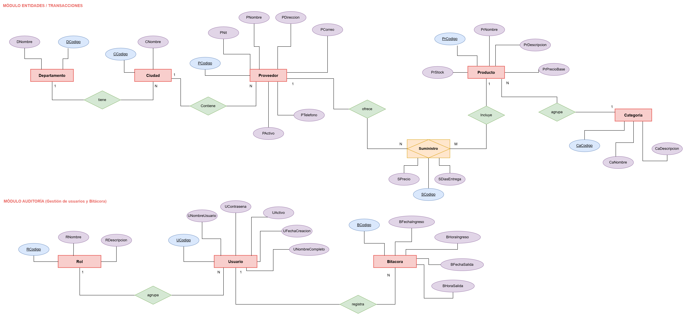
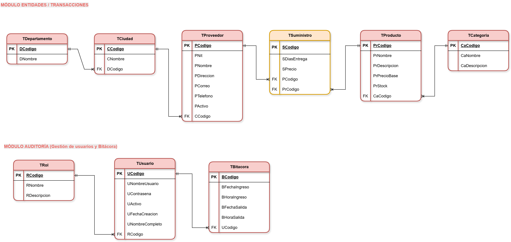

# Sistema de gestión de proveedores, productos y categorías

Proyecto final de **Bases de Datos I** — Programa de Ingeniería de Sistemas y Computación, Universidad del Quindío (2026-2).

Aplicación de escritorio que permite a una empresa comercial registrar a sus **proveedores** (en cualquier ciudad de Colombia), sus **productos** agrupados por **categorías**, y saber **qué proveedor vende cada producto, a qué precio y en cuántos días lo entrega**. Incluye login con tres tipos de usuario, bitácora de entradas y salidas, consultas SQL y reportes en PDF.

## Tecnologías

| Elemento | Herramienta |
| --- | --- |
| Lenguaje | Java (JDK 25) |
| Interfaz gráfica | Swing (escritorio) |
| Base de datos | Oracle (XE 21c / Free 23ai) |
| Conexión | JDBC puro con el driver `ojdbc11` |
| Reportes | Apache PDFBox 3.0.8 (PDF mostrado dentro de la aplicación) |
| Construcción | Maven |

**No se usa ningún framework**, como pide el enunciado: solo JDBC y PDFBox, que son librerías.

## Módulos

| Módulo | Qué hace |
| --- | --- |
| **Ingreso** | Login con usuario y contraseña (hash SHA-256), máximo 3 intentos. |
| **Entidades** | CRUD de Departamentos, Ciudades, Categorías, Productos y Proveedores. |
| **Transacciones** | Suministros: asignar productos a proveedores con su precio y días de entrega. |
| **Reportes/Consultas** | 5 consultas SQL (3 con JOIN y 2 con subconsultas) y 5 reportes en PDF con filtros. |
| **Auditoría** | Gestión de usuarios y bitácora de entradas y salidas (fecha y hora). |

## Tipos de usuario

| Acción | Administrador | Tradicional | Esporádico |
| --- | :---: | :---: | :---: |
| Crear y gestionar usuarios | ✅ | ❌ | ❌ |
| CRUD de entidades y transacciones | ✅ | ✅ | ❌ |
| Consultas y reportes | ✅ | ✅ | ✅ |
| Ver la bitácora | ✅ | ❌ | ❌ |

Solo puede existir **un administrador**: lo garantiza un índice único en la base de datos (`ux_usuario_unico_admin`).

## Modelo de datos

Nueve tablas: `TDepartamento`, `TCiudad`, `TProveedor`, `TCategoria`, `TProducto`, `TSuministro` (resuelve la relación muchos a muchos entre Proveedor y Producto), `TRol`, `TUsuario` y `TBitacora`.





El diccionario de datos completo y la justificación de la normalización (3FN) están en [`docs/DocumentoEntregable.md`](docs/DocumentoEntregable.md).

## Consultas y reportes

**Consultas** (`modelo/dao/ConsultaDAO.java`, detalle en [`docs/Consultas.md`](docs/Consultas.md)):

| | Consulta | Tipo |
| --- | --- | --- |
| a | Proveedores con su ciudad y departamento | JOIN de 3 tablas |
| b | Productos con sus proveedores y precio de suministro | JOIN de 3 tablas |
| c | Productos por categoría y proveedor | JOIN de 4 tablas |
| d | Productos con precio mayor al promedio de su categoría | Subconsulta correlacionada |
| e | Proveedores sin suministros | Subconsulta con `NOT EXISTS` |

**Reportes en PDF** (`modelo/dao/ReporteDAO.java`):

| # | Reporte | Filtros |
| --- | --- | --- |
| 1 | Proveedores por ubicación | Departamento y ciudad |
| 2 | Productos por precio y stock | Rangos de precio y de stock |
| 3 | Productos de un proveedor | Proveedor |
| 4 | Productos de una categoría | Categoría |
| 5 | Resumen por categoría | Una categoría o todas |

## Estructura del proyecto

```
ProyectoBasesDeDatos/
├── docs/                         Documento entregable, diagramas, consultas y guías de prueba
├── sql/
│   ├── 00_borrar_tablas.sql      Borra las tablas (para empezar de cero)
│   ├── 01_crear_tablas.sql       Crea las 9 tablas, llaves, restricciones e índices
│   ├── 02_datos_iniciales.sql    Roles, administrador y ubicaciones base
│   └── 03_datos_prueba.sql       Datos de prueba y usuarios tradicional y esporádico
├── src/main/java/co/edu/uniquindio/proyectobasesdedatos/
│   ├── config/                   Conexión a Oracle (ConexionOracle)
│   ├── controlador/              Validaciones, permisos y manejo de errores
│   ├── modelo/dao/               Acceso a datos (SQL con PreparedStatement)
│   ├── modelo/dto/               Objetos que representan las filas de cada tabla
│   ├── util/                     Sesión, seguridad (SHA-256), errores de Oracle y PDF
│   ├── vista/                    Ventanas Swing por módulo
│   └── ProyectoBasesDeDatos.java Clase principal (main)
├── src/main/resources/
│   └── db.properties.example     Plantilla de la conexión
└── pom.xml
```

Arquitectura en capas: **vista → controlador → DAO → Oracle**. Las vistas no escriben SQL y los DAO no muestran mensajes.

## Instalación y ejecución

### 1. Requisitos

- JDK 25
- Maven 3.9 o superior (o el que trae el IDE)
- Oracle Database XE 21c, Free 23ai u otra versión 12c o superior
- SQL Developer (u otra herramienta para ejecutar scripts)

### 2. Crear el usuario de la base de datos

Conectado como `SYSTEM` en SQL Developer:

```sql
-- Solo si la consulta SELECT SYS_CONTEXT('USERENV','CON_NAME') FROM dual; devuelve CDB$ROOT
ALTER SESSION SET CONTAINER = XEPDB1;   -- en Oracle Free 23ai: FREEPDB1

CREATE USER PROYECTO_BD IDENTIFIED BY "Proyecto123"
    DEFAULT TABLESPACE USERS QUOTA UNLIMITED ON USERS;
GRANT CREATE SESSION, CREATE TABLE, CREATE VIEW, CREATE SEQUENCE TO PROYECTO_BD;
```

### 3. Crear las tablas y cargar los datos

Crear una conexión en SQL Developer con el usuario `PROYECTO_BD` (servicio `XEPDB1`, puerto `1521`) y ejecutar **en orden** con *Ejecutar script* (F5):

1. `sql/00_borrar_tablas.sql` — la primera vez muestra `ORA-00942`; es normal.
2. `sql/01_crear_tablas.sql`
3. `sql/02_datos_iniciales.sql`
4. `sql/03_datos_prueba.sql`

### 4. Configurar la conexión

Copiar `src/main/resources/db.properties.example` como `src/main/resources/db.properties` y escribir los datos:

```properties
db.url=jdbc:oracle:thin:@//localhost:1521/XEPDB1
db.user=PROYECTO_BD
db.password=Proyecto123
```

`db.properties` está en el `.gitignore`: cada integrante tiene el suyo y no se sube a GitHub.

### 5. Ejecutar

Desde el IDE (IntelliJ, NetBeans o Eclipse) abrir el proyecto como proyecto Maven y ejecutar `ProyectoBasesDeDatos.java`, o desde la terminal:

```bash
mvn package
mvn exec:java
```

Si Oracle no está activo o los datos de `db.properties` no son correctos, la aplicación muestra un mensaje de error de conexión y se cierra.

## Usuarios de prueba

| Usuario | Contraseña | Rol |
| --- | --- | --- |
| `admin` | `Admin123*` | Administrador |
| `tradicional` | `Trad123*` | Tradicional |
| `esporadico` | `Espo123*` | Esporádico |

Se recomienda cambiar la contraseña del administrador después del primer ingreso, desde **Auditoría → Gestión de usuarios**.

## Documentación

- [`docs/DocumentoEntregable.md`](docs/DocumentoEntregable.md) — explicación general, diagramas, diccionario de datos y normalización.
- [`docs/Consultas.md`](docs/Consultas.md) — SQL y justificación de cada consulta.
- [`docs/PruebasIntegracion.md`](docs/PruebasIntegracion.md) — guía para probar la aplicación con los tres roles.
- [`docs/PruebasEntidades.md`](docs/PruebasEntidades.md) — casos de prueba del módulo de entidades.

## Integrantes

- Juliana Villota López
- Sara Sofia Bolaños Pelayo
- Santiago Arias Rodriguez
