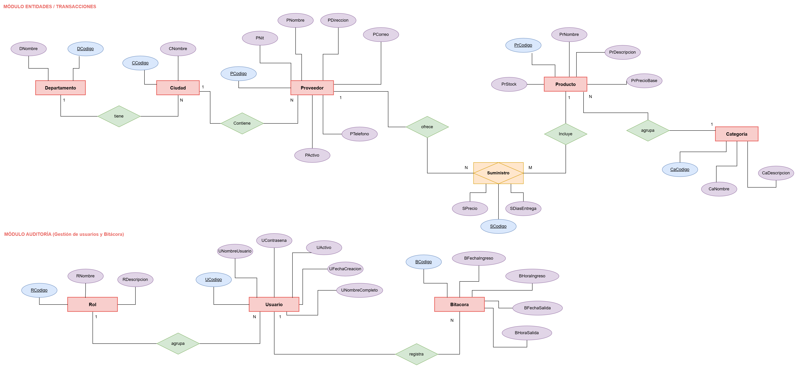
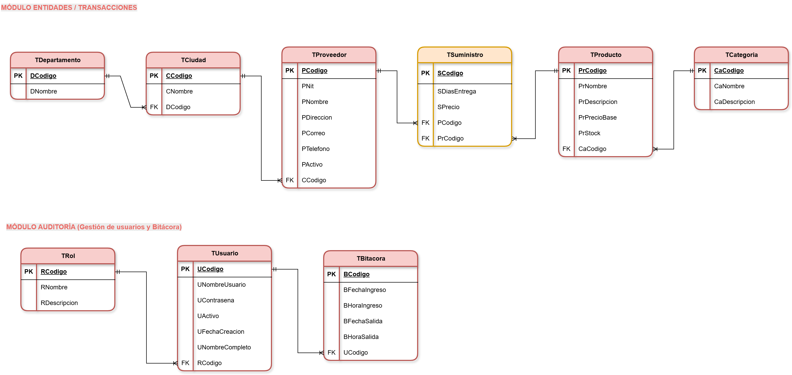

<div align="center">

**Universidad del Quindío**<br>
Facultad de Ingeniería<br>
Ingeniería de Sistemas y Computación

# Proyecto Final — Bases de Datos I

**Integrantes**<br>
Juliana Villota López<br>
Sara Sofia Bolaños Pelayo<br>
Santiago Arias Rodriguez

**Docente**<br>
Jorge Orlando Herrera Morales

Armenia – Quindío, 2026

</div>

## Contenido

- [1. Diagrama Entidad-Relación](#1-diagrama-entidad-relación)
    - [1.1 Módulo Entidades / Transacciones](#11-módulo-entidades--transacciones)
    - [1.2 Módulo Auditoría](#12-módulo-auditoría)
    - [1.3 Decisiones de diseño](#13-decisiones-de-diseño)
- [2. Diccionario de datos](#2-diccionario-de-datos)
    - [2.1 TDepartamento](#21-tdepartamento)
    - [2.2 TCiudad](#22-tciudad)
    - [2.3 TCategoria](#23-tcategoria)
    - [2.4 TProveedor](#24-tproveedor)
    - [2.5 TProducto](#25-tproducto)
    - [2.6 TSuministro](#26-tsuministro)
    - [2.7 TRol](#27-trol)
    - [2.8 TUsuario](#28-tusuario)
    - [2.9 TBitacora](#29-tbitacora)
- [3. Diagrama relacional normalizado](#3-diagrama-relacional-normalizado)
    - [3.1 Justificación de la normalización](#31-justificación-de-la-normalización)
- [4. Explicación de la aplicación](#4-explicación-de-la-aplicación)
    - [4.1 Problema](#41-problema)
    - [4.2 Tecnologías](#42-tecnologías)
    - [4.3 Módulos](#43-módulos)
    - [4.4 Tipos de usuario y matriz de permisos](#44-tipos-de-usuario-y-matriz-de-permisos)
    - [4.5 Arquitectura en capas](#45-arquitectura-en-capas)
    - [4.6 Seguridad](#46-seguridad)
    - [4.7 Consultas](#47-consultas)
    - [4.8 Reportes](#48-reportes)
    - [4.9 Instalación y ejecución](#49-instalación-y-ejecución)

# 1. Diagrama Entidad-Relación



*Figura 1. Diagrama Entidad-Relación*

El modelo tiene 8 entidades y una entidad asociativa (Suministro), organizadas en dos módulos.

## 1.1 Módulo Entidades / Transacciones

| **Relación**     | **Entidades**                                 | **Cardinalidad** | **Explicación**                                                                                                                                                                                                                                                                                                                                                                                                                                                         |
|------------------|-----------------------------------------------|------------------|-------------------------------------------------------------------------------------------------------------------------------------------------------------------------------------------------------------------------------------------------------------------------------------------------------------------------------------------------------------------------------------------------------------------------------------------------------------------------|
| tiene            | Departamento – Ciudad                         | 1 : N            | Un departamento tiene muchas ciudades; cada ciudad pertenece a un solo departamento. En el modelo relacional TCiudad guarda la llave foránea DCodigo.                                                                                                                                                                                                                                                                                                                   |
| contiene         | Ciudad – Proveedor                            | 1 : N            | En una ciudad puede haber muchos proveedores; cada proveedor está ubicado en una sola ciudad. TProveedor guarda CCodigo.                                                                                                                                                                                                                                                                                                                                                |
| agrupa           | Categoría – Producto                          | 1 : N            | Una categoría agrupa muchos productos (una familia de productos); cada producto pertenece a una sola categoría. TProducto guarda CaCodigo.                                                                                                                                                                                                                                                                                                                              |
| ofrece / incluye | Proveedor – Producto (a través de Suministro) | N : M            | Como dice el enunciado, un proveedor puede proveer varios productos y un producto puede ser adquirido de varios proveedores. Esta relación muchos a muchos se resuelve con la entidad asociativa Suministro, que además tiene atributos propios: el precio al que ese proveedor vende ese producto y los días de entrega. Un proveedor ofrece N suministros y un producto está incluido en M suministros; cada suministro une exactamente un proveedor con un producto. |

## 1.2 Módulo Auditoría

| **Relación** | **Entidades**      | **Cardinalidad** | **Explicación**                                                                                                                                                                                                                                                        |
|--------------|--------------------|------------------|------------------------------------------------------------------------------------------------------------------------------------------------------------------------------------------------------------------------------------------------------------------------|
| agrupa       | Rol – Usuario      | 1 : N            | Cada usuario tiene un solo rol (Administrador, Tradicional o Esporádico) y un rol puede tener muchos usuarios. La excepción es el rol Administrador, que por regla del negocio solo puede tener un usuario (se controla con un índice único). TUsuario guarda RCodigo. |
| registra     | Usuario – Bitácora | 1 : N            | Cada vez que un usuario entra al sistema se registra una fila en la bitácora con la fecha y hora de entrada y, al salir, la fecha y hora de salida. Un usuario tiene muchos registros; cada registro es de un solo usuario. TBitacora guarda UCodigo.                  |

## 1.3 Decisiones de diseño

- Ciudad y Departamento como entidades (y no como texto dentro del proveedor) para no repetir nombres, evitar errores de escritura y poder filtrar los reportes por ubicación.

- Llaves primarias sustitutas numéricas (...Codigo) generadas con IDENTITY de Oracle. Los datos naturales que deben ser únicos (NIT del proveedor, nombre de usuario, nombres de departamento, categoría y rol) tienen restricción UNIQUE.

- Suministro con llave propia (SCodigo) y además UNIQUE (PCodigo, PrCodigo) para que un proveedor no pueda tener dos veces el mismo producto.

- Proveedor activo/inactivo (PActivo) para "dar de baja" un proveedor sin borrar su historial de suministros.

- Bitácora con fecha y hora separadas, tal como aparecen en el diagrama ER (BFechaIngreso, BHoraIngreso, BFechaSalida, BHoraSalida).

# 2. Diccionario de datos

## 2.1 TDepartamento

Departamentos de Colombia donde se ubican las ciudades de los proveedores.

**Diccionario de datos tabla TDepartamento**

| Atributo | Descripción | Tipo de dato | Observaciones |
|---|---|---|---|
| DCodigo                                      | Código único del departamento.                                   | NUMBER (numérico)                           | Llave primaria (pk_departamento). Se genera automáticamente (IDENTITY).            |
| DNombre                                      | Nombre del departamento (p. ej. "Quindío"). No se puede repetir. | VARCHAR2(60) (texto de hasta 60 caracteres) | Obligatorio (NOT NULL). Valor único (uq_departamento_nombre): no se puede repetir. |

## 2.2 TCiudad

Ciudades (municipios) donde están ubicados los proveedores. Cada ciudad pertenece a un departamento.

**Diccionario de datos tabla TCiudad**

| Atributo | Descripción | Tipo de dato | Observaciones |
|---|---|---|---|
| CCodigo                                | Código único de la ciudad.                                                          | NUMBER (numérico)                           | Llave primaria (pk_ciudad). Se genera automáticamente (IDENTITY).                                              |
| CNombre                                | Nombre de la ciudad (p. ej. "Armenia"). Puede repetirse en departamentos distintos. | VARCHAR2(60) (texto de hasta 60 caracteres) | Obligatorio (NOT NULL).                                                                                        |
| DCodigo                                | Departamento al que pertenece la ciudad.                                            | NUMBER (numérico)                           | Obligatorio (NOT NULL). Llave foránea a TDepartamento(DCodigo) (fk_ciudad_departamento). Índice ix_ciudad_dep. |

## 2.3 TCategoria

Categorías o familias en las que se clasifican los productos.

**Diccionario de datos tabla TCategoria**

| Atributo | Descripción | Tipo de dato | Observaciones |
|---|---|---|---|
| CaCodigo                                  | Código único de la categoría.                                     | NUMBER (numérico)                             | Llave primaria (pk_categoria). Se genera automáticamente (IDENTITY).            |
| CaNombre                                  | Nombre de la categoría (p. ej. "Papelería"). No se puede repetir. | VARCHAR2(60) (texto de hasta 60 caracteres)   | Obligatorio (NOT NULL). Valor único (uq_categoria_nombre): no se puede repetir. |
| CaDescripcion                             | Descripción de qué tipo de productos agrupa.                      | VARCHAR2(200) (texto de hasta 200 caracteres) | Opcional (puede quedar vacío).                                                  |

## 2.4 TProveedor

Empresas a las que se les pueden hacer pedidos de productos.

**Diccionario de datos tabla TProveedor**

| Atributo | Descripción | Tipo de dato | Observaciones |
|---|---|---|---|
| PCodigo                                   | Código único del proveedor.                                                   | NUMBER (numérico)                             | Llave primaria (pk_proveedor). Se genera automáticamente (IDENTITY).                                     |
| PNit                                      | NIT de la empresa (p. ej. "900123456-7"). No se puede repetir.                | VARCHAR2(20) (texto de hasta 20 caracteres)   | Obligatorio (NOT NULL). Valor único (uq_proveedor_nit): no se puede repetir.                             |
| PNombre                                   | Razón social del proveedor.                                                   | VARCHAR2(100) (texto de hasta 100 caracteres) | Obligatorio (NOT NULL).                                                                                  |
| PDireccion                                | Dirección física.                                                             | VARCHAR2(120) (texto de hasta 120 caracteres) | Opcional (puede quedar vacío).                                                                           |
| PCorreo                                   | Correo electrónico de contacto (la aplicación valida el formato).             | VARCHAR2(100) (texto de hasta 100 caracteres) | Opcional (puede quedar vacío).                                                                           |
| PTelefono                                 | Teléfono de contacto. Es texto para admitir "+", espacios y guiones.          | VARCHAR2(20) (texto de hasta 20 caracteres)   | Opcional (puede quedar vacío).                                                                           |
| PActivo                                   | 1 = activo, 0 = inactivo. Solo a los activos se les pueden asignar productos. | NUMBER(1) (un dígito: 0 o 1)                  | Obligatorio (NOT NULL). Valor por defecto: 1. Restricción ck_proveedor_activo: PActivo IN (0, 1).        |
| CCodigo                                   | Ciudad donde está ubicado el proveedor.                                       | NUMBER (numérico)                             | Obligatorio (NOT NULL). Llave foránea a TCiudad(CCodigo) (fk_proveedor_ciudad). Índice ix_proveedor_ciu. |

## 2.5 TProducto

Productos que la empresa puede pedir a los proveedores.

**Diccionario de datos tabla TProducto**

| Atributo | Descripción | Tipo de dato | Observaciones |
|---|---|---|---|
| PrCodigo                                 | Código único del producto.                                          | NUMBER (numérico)                             | Llave primaria (pk_producto). Se genera automáticamente (IDENTITY).                                           |
| PrNombre                                 | Nombre del producto.                                                | VARCHAR2(100) (texto de hasta 100 caracteres) | Obligatorio (NOT NULL).                                                                                       |
| PrDescripcion                            | Descripción o características.                                      | VARCHAR2(250) (texto de hasta 250 caracteres) | Opcional (puede quedar vacío).                                                                                |
| PrPrecioBase                             | Precio de referencia del producto (hasta 10 enteros y 2 decimales). | NUMBER(12,2) (hasta 10 enteros y 2 decimales) | Obligatorio (NOT NULL). Restricción ck_producto_precio: PrPrecioBase \>= 0.                                   |
| PrStock                                  | Unidades disponibles en inventario.                                 | NUMBER(8) (entero de hasta 8 dígitos)         | Obligatorio (NOT NULL). Valor por defecto: 0. Restricción ck_producto_stock: PrStock \>= 0.                   |
| CaCodigo                                 | Categoría a la que pertenece el producto.                           | NUMBER (numérico)                             | Obligatorio (NOT NULL). Llave foránea a TCategoria(CaCodigo) (fk_producto_categoria). Índice ix_producto_cat. |

## 2.6 TSuministro

Entidad asociativa que resuelve la relación muchos a muchos entre Proveedor y Producto: indica qué productos ofrece cada proveedor, a qué precio y en cuántos días los entrega.

**Diccionario de datos tabla TSuministro**

| Atributo | Descripción | Tipo de dato | Observaciones |
|---|---|---|---|
| SCodigo                                    | Código único del suministro.                                   | NUMBER (numérico)                             | Llave primaria (pk_suministro). Se genera automáticamente (IDENTITY).                                                                                                                                                                     |
| SDiasEntrega                               | Días que tarda el proveedor en entregar el producto (0 a 999). | NUMBER(3) (entero de hasta 3 dígitos)         | Obligatorio (NOT NULL). Restricción ck_suministro_dias: SDiasEntrega \>= 0.                                                                                                                                                               |
| SPrecio                                    | Precio al que este proveedor vende este producto.              | NUMBER(12,2) (hasta 10 enteros y 2 decimales) | Obligatorio (NOT NULL). Restricción ck_suministro_precio: SPrecio \>= 0.                                                                                                                                                                  |
| PCodigo                                    | Proveedor que ofrece el producto.                              | NUMBER (numérico)                             | Obligatorio (NOT NULL). Llave foránea a TProveedor(PCodigo) (fk_suministro_proveedor). Junto con PrCodigo forma el valor único uq_suministro_prov_prod: un proveedor no puede tener dos veces el mismo producto.                          |
| PrCodigo                                   | Producto ofrecido.                                             | NUMBER (numérico)                             | Obligatorio (NOT NULL). Llave foránea a TProducto(PrCodigo) (fk_suministro_producto). Índice ix_suministro_prod. Junto con PCodigo forma el valor único uq_suministro_prov_prod: un proveedor no puede tener dos veces el mismo producto. |

Un proveedor no puede tener dos veces el mismo producto. Este índice único también sirve como índice de la llave foránea PCodigo (es su primera columna).

## 2.7 TRol

Tipos de usuario del sistema. Los códigos son fijos porque el índice del administrador y la clase RolDTO dependen de ellos.

**Diccionario de datos tabla TRol**

| Atributo | Descripción | Tipo de dato | Observaciones |
|---|---|---|---|
| RCodigo                             | Código del rol: 1 = ADMINISTRADOR, 2 = TRADICIONAL, 3 = ESPORADICO. | NUMBER (numérico)                             | Llave primaria (pk_rol). Se genera automáticamente (IDENTITY).            |
| RNombre                             | Nombre del rol.                                                     | VARCHAR2(30) (texto de hasta 30 caracteres)   | Obligatorio (NOT NULL). Valor único (uq_rol_nombre): no se puede repetir. |
| RDescripcion                        | Qué puede hacer el rol.                                             | VARCHAR2(150) (texto de hasta 150 caracteres) | Opcional (puede quedar vacío).                                            |

## 2.8 TUsuario

Usuarios que pueden ingresar a la aplicación.

**Diccionario de datos tabla TUsuario**

| Atributo | Descripción | Tipo de dato | Observaciones |
|---|---|---|---|
| UCodigo                                 | Código único del usuario.                                                                              | NUMBER (numérico)                             | Llave primaria (pk_usuario). Se genera automáticamente (IDENTITY).                                                                                                             |
| UNombreUsuario                          | Nombre con el que ingresa (login). La aplicación exige 4 a 30 caracteres sin espacios.                 | VARCHAR2(30) (texto de hasta 30 caracteres)   | Obligatorio (NOT NULL). Valor único (uq_usuario_nombre): no se puede repetir.                                                                                                  |
| UContrasena                             | Hash SHA-256 de la contraseña en hexadecimal (64 caracteres). Nunca se guarda la clave en texto plano. | VARCHAR2(100) (texto de hasta 100 caracteres) | Obligatorio (NOT NULL).                                                                                                                                                        |
| UActivo                                 | 1 = puede ingresar, 0 = bloqueado.                                                                     | NUMBER(1) (un dígito: 0 o 1)                  | Obligatorio (NOT NULL). Valor por defecto: 1. Restricción ck_usuario_activo: UActivo IN (0, 1).                                                                                |
| UFechaCreacion                          | Fecha y hora en que se creó el usuario.                                                                | DATE (fecha y hora)                           | Obligatorio (NOT NULL). Valor por defecto: SYSDATE.                                                                                                                            |
| UNombreCompleto                         | Nombre real de la persona.                                                                             | VARCHAR2(100) (texto de hasta 100 caracteres) | Obligatorio (NOT NULL).                                                                                                                                                        |
| RCodigo                                 | Rol del usuario.                                                                                       | NUMBER (numérico)                             | Obligatorio (NOT NULL). Llave foránea a TRol(RCodigo) (fk_usuario_rol). Índice ix_usuario_rol. Índice único ux_usuario_unico_admin: impide que exista más de un administrador. |

## 2.9 TBitacora

Registro de cada ingreso y salida de los usuarios del sistema.

**Diccionario de datos tabla TBitacora**

| Atributo | Descripción | Tipo de dato | Observaciones |
|---|---|---|---|
| BCodigo                                  | Código único del registro.                              | NUMBER (numérico)                         | Llave primaria (pk_bitacora). Se genera automáticamente (IDENTITY).                                                                                   |
| BFechaIngreso                            | Fecha en que el usuario ingresó.                        | DATE (fecha)                              | Obligatorio (NOT NULL). Valor por defecto: TRUNC(SYSDATE). Restricción ck_bitacora_fecha_ing: solo el día, sin hora.                                  |
| BHoraIngreso                             | Hora de ingreso (p. ej. "14:05:09").                    | VARCHAR2(8) (texto de hasta 8 caracteres) | Obligatorio (NOT NULL). Valor por defecto: TO_CHAR(SYSDATE, 'HH24:MI:SS'). Restricción ck_bitacora_hora_ing: formato HH24:MI:SS válido (REGEXP_LIKE). |
| BFechaSalida                             | Fecha de salida. NULL mientras la sesión sigue abierta. | DATE (fecha)                              | Opcional (puede quedar vacío). Restricción ck_bitacora_fecha_sal: solo el día, sin hora.                                                              |
| BHoraSalida                              | Hora de salida. NULL mientras la sesión sigue abierta.  | VARCHAR2(8) (texto de hasta 8 caracteres) | Opcional (puede quedar vacío). Restricción ck_bitacora_hora_sal: formato HH24:MI:SS válido.                                                           |
| UCodigo                                  | Usuario que ingresó.                                    | NUMBER (numérico)                         | Obligatorio (NOT NULL). Llave foránea a TUsuario(UCodigo) (fk_bitacora_usuario). Índice ix_bitacora_usu.                                              |

# 3. Diagrama relacional normalizado



*Figura 2. Diagrama relacional normalizado*

Paso del modelo ER al relacional:

- Cada entidad se convirtió en una tabla con su llave primaria.

- Cada relación 1 : N se convirtió en una llave foránea en la tabla del lado N (TCiudad.DCodigo, TProveedor.CCodigo, TProducto.CaCodigo, TUsuario.RCodigo, TBitacora.UCodigo).

- La relación N : M entre Proveedor y Producto se convirtió en la tabla TSuministro, con una llave foránea hacia cada lado y sus atributos propios (precio y días de entrega).

## 3.1 Justificación de la normalización

### Primera Forma Normal (1FN)

Una tabla está en 1FN si todos sus atributos son atómicos (un solo valor por celda), no hay grupos repetitivos y cada fila se identifica por una llave primaria.

- Todas las tablas tienen llave primaria.

- No hay columnas con listas: por ejemplo, en lugar de guardar en el proveedor una lista de "productos que vende", cada pareja proveedor-producto es una fila de TSuministro.

- La ubicación no se guarda como un texto "Armenia, Quindío", sino separada en TCiudad y TDepartamento.

- La fecha y la hora de la bitácora se guardan en columnas separadas, cada una con un solo valor.

### Segunda Forma Normal (2FN)

Está en 1FN y ningún atributo que no es llave depende solo de una parte de una llave compuesta.

- Todas las tablas usan una llave primaria simple (una sola columna ...Codigo), así que no puede existir dependencia parcial.

- El caso a revisar es TSuministro, cuya llave candidata natural es compuesta: (PCodigo, PrCodigo). Sus atributos SPrecio y SDiasEntrega dependen de la pareja completa (el precio y los días son de ese proveedor para ese producto), no solo del proveedor ni solo del producto. En cambio, el nombre del proveedor o el precio base del producto (que sí dependen de una sola parte) no están en TSuministro, sino en TProveedor y TProducto. Por eso cumple 2FN.

### Tercera Forma Normal (3FN)

Está en 2FN y no hay dependencias transitivas: ningún atributo que no es llave depende de otro atributo que tampoco es llave.

- TProveedor guarda solo CCodigo, no el nombre de la ciudad ni el del departamento. Si guardara CNombre y DNombre, estos dependerían de CCodigo (transitividad PCodigo → CCodigo → CNombre), y al cambiar el nombre de una ciudad habría que actualizar muchos proveedores. Por eso la ciudad y el departamento están en sus propias tablas.

- Del mismo modo, TCiudad guarda solo DCodigo (no el nombre del departamento), TProducto guarda solo CaCodigo (no el nombre de la categoría), TUsuario guarda solo RCodigo (no el nombre del rol) y TBitacora guarda solo UCodigo (no el nombre del usuario).

- No se guardan datos calculados: la diferencia entre el precio de suministro y el precio base, los promedios por categoría o la cantidad de proveedores de un producto se calculan en las consultas y reportes.

Con esto el modelo queda en 3FN: cada dato se guarda en un solo lugar, y los nombres que se ven juntos en la aplicación se obtienen con JOIN.

# 4. Explicación de la aplicación

## 4.1 Problema

Las empresas comerciales necesitan saber a qué proveedores les pueden hacer los pedidos de sus productos. Los proveedores pueden estar en cualquier ciudad de Colombia, un proveedor puede ofrecer varios productos y un mismo producto se puede conseguir con varios proveedores (cada uno con su propio precio y tiempo de entrega). Además, los productos se clasifican en categorías (familias de productos).

La aplicación que construimos permite registrar toda esta información, asignar qué productos ofrece cada proveedor, consultarla y sacar reportes en PDF. También tiene un sistema de seguridad con login, tres tipos de usuario y una bitácora de entradas y salidas.

## 4.2 Tecnologías

| **Elemento**  | **Herramienta**                                                         |
|---------------|-------------------------------------------------------------------------|
| Lenguaje      | Java (JDK 25)                                                           |
| Base de datos | Oracle (XE 21c / Free 23ai)                                             |
| Conexión      | JDBC                                                                    |
| Reportes      | Apache PDFBox (genera el PDF) y un visor propio dentro de la aplicación |
| Construcción  | Maven                                                                   |

## 4.3 Módulos

La ventana principal (MenuPrincipal) es un escritorio con ventanas internas y tiene los menús que pide el ejercicio:

| **Módulo**         | **Menú / Ventana**                                          | **Qué hace**                                                                                                                                                                          |
|--------------------|-------------------------------------------------------------|---------------------------------------------------------------------------------------------------------------------------------------------------------------------------------------|
| Ingreso            | Ventana de Login                                            | Pide usuario y contraseña, valida contra TUsuario (clave en SHA-256), permite máximo 3 intentos y registra la entrada en la bitácora. Si el usuario está inactivo no lo deja entrar.  |
| Entidades          | Departamentos, Ciudades, Categorías, Productos, Proveedores | CRUD completo (INSERT, SELECT, UPDATE, DELETE) de cada entidad, con búsqueda por nombre y validaciones.                                                                               |
| Transacciones      | Suministros                                                 | Asigna productos a proveedores con su precio de suministro y días de entrega (tabla TSuministro, que resuelve la relación muchos a muchos).                                           |
| Reportes/Consultas | Consultas, Reportes                                         | 5 consultas (3 con JOIN de 3 o más tablas y 2 con subconsultas) mostradas en una tabla, y 5 reportes en PDF filtrados por el usuario y mostrados en un visor dentro de la aplicación. |
| Auditoría          | Gestión de usuarios, Bitácora                               | El administrador crea, edita, activa/desactiva, elimina usuarios y les cambia la clave; también consulta la bitácora de entradas y salidas filtrando por fechas y usuario.            |
| Sesión             | Cerrar sesión, Salir                                        | Registra la salida en la bitácora. "Cerrar sesión" vuelve al Login y "Salir" cierra la aplicación.                                                                                    |

## 4.4 Tipos de usuario y matriz de permisos

El enunciado pide tres tipos de usuario. Están en la tabla TRol con códigos fijos:

| **Código** | **Rol**       | **Descripción**                                                        |
|------------|---------------|------------------------------------------------------------------------|
| 1          | ADMINISTRADOR | Único usuario que puede crear nuevos usuarios. Solo puede existir uno. |
| 2          | TRADICIONAL   | Ejecuta los CRUD de gestión de datos.                                  |
| 3          | ESPORADICO    | Solo ejecuta las consultas (y los reportes).                           |

| **Módulo / acción**                                                              | **Administrador** | **Tradicional** | **Esporádico** |
|----------------------------------------------------------------------------------|-------------------|-----------------|----------------|
| Ingresar al sistema (Login)                                                      | ✔                 | ✔               | ✔              |
| Entidades (CRUD de Departamentos, Ciudades, Categorías, Productos y Proveedores) | ✔                 | ✔               | ✘              |
| Transacciones (Suministros)                                                      | ✔                 | ✔               | ✘              |
| Consultas                                                                        | ✔                 | ✔               | ✔              |
| Reportes en PDF                                                                  | ✔                 | ✔               | ✔              |
| Gestión de usuarios                                                              | ✔                 | ✘               | ✘              |
| Bitácora de entrada y salida                                                     | ✔                 | ✘               | ✘              |
| Cerrar sesión / Salir                                                            | ✔                 | ✔               | ✔              |

Los permisos se controlan en dos lugares:

1.  En el menú: MenuPrincipal solo agrega los menús que el rol puede usar (por ejemplo, el esporádico no ve Entidades ni Transacciones, y solo el administrador ve Auditoría).

2.  En los controladores: antes de guardar, editar o eliminar, cada controlador vuelve a revisar el permiso con la clase Sesion (puedeEditar(), puedeGestionarUsuarios(), puedeVerBitacora()). Así, aunque alguien llegara a abrir una ventana, el controlador no deja hacer la operación.

## 4.5 Arquitectura en capas

La aplicación sigue el patrón Modelo – Vista – Controlador con objetos DAO y DTO, como recomienda el anexo del proyecto.

| **Paquete** | **Responsabilidad**                                                                                                                                                                                                                                                                                                |
|-------------|--------------------------------------------------------------------------------------------------------------------------------------------------------------------------------------------------------------------------------------------------------------------------------------------------------------------|
| vista       | Solo muestran datos y capturan eventos; nunca escriben SQL. Los errores se muestran con JOptionPane.                                                                                                                                                                                                               |
| controlador | Valida los datos (obligatorios, longitudes, formatos, rangos), revisa permisos y llama al DAO. Si algo falla lanza ControladorException con un mensaje claro en español.                                                                                                                                           |
| modelo.dao  | Una clase por tabla (ProveedorDAO, ProductoDAO, SuministroDAO, UsuarioDAO, BitacoraDAO, etc.) con las sentencias INSERT, SELECT, UPDATE y DELETE. Usan siempre PreparedStatement con parámetros ? (evita la inyección SQL) y try-with-resources para cerrar conexiones. No muestran mensajes: lanzan SQLException. |
| modelo.dto  | Objetos que representan una fila de cada tabla (ProveedorDTO, ProductoDTO, ...). Algunos traen además datos de solo lectura que vienen de un JOIN (por ejemplo, el nombre de la ciudad del proveedor).                                                                                                             |

## 4.6 Seguridad

- Contraseñas con hash SHA-256: la clave nunca se guarda en texto plano. La clase Seguridad calcula el SHA-256 y lo guarda en hexadecimal (64 caracteres) en TUsuario.UContrasena. Al ingresar se calcula el hash de lo que escribió el usuario y se compara con el guardado.

- Un solo administrador, garantizado por la base de datos: además de la validación en UsuarioControlador, el script crea un índice único basado en función:

```sql
CREATE UNIQUE INDEX ux_usuario_unico_admin
    ON TUsuario (CASE WHEN RCodigo = 1 THEN 1 END);
```

Para los usuarios que no son administradores la expresión da NULL y Oracle no indexa los NULL, así que no cuentan. Para el administrador da 1, y como el índice es único, un segundo administrador provoca el error ORA-00001. Aunque alguien intente insertarlo directamente desde SQL Developer, la base de datos no lo permite.

## 4.7 Consultas

El enunciado pide:

- Tres consultas con JOIN que junten al menos datos de 3 tablas.

- Dos consultas que posean subconsultas y que relacionen dos tablas.

Están en modelo/dao/ConsultaDAO.java y se ejecutan desde Reportes/Consultas en Consultas(las pueden usar los tres roles). Aquí una vista general de las consultas:

| **\#** | **Consulta**                                                                       | **Tipo**                                                                  | **Tablas**                                     | **Requisito que cumple**                    |
|--------|------------------------------------------------------------------------------------|---------------------------------------------------------------------------|------------------------------------------------|---------------------------------------------|
| a      | Proveedores con ciudad y departamento                                              | JOIN                                                                      | TProveedor, TCiudad, TDepartamento             | JOIN de 3 tablas (1 de 3)                   |
| b      | Productos con proveedores y precio de suministro (y diferencia con el precio base) | JOIN                                                                      | TProducto, TSuministro, TProveedor             | JOIN de 3 tablas (2 de 3)                   |
| c      | Productos por categoría y proveedor, con stock y días de entrega                   | JOIN                                                                      | TProducto, TCategoria, TSuministro, TProveedor | JOIN de 4 tablas (3 de 3)                   |
| d      | Productos con precio base mayor al promedio de su categoría                        | Subconsulta correlacionada en el WHERE + subconsulta escalar en el SELECT | TProducto, TCategoria                          | Subconsulta que relaciona 2 tablas (1 de 2) |
| e      | Proveedores sin suministros                                                        | Subconsulta con NOT EXISTS                                                | TProveedor, TSuministro                        | Subconsulta que relaciona 2 tablas (2 de 2) |

Ejemplo (consulta d):

```sql
SELECT ca.CaNombre, pr.PrNombre, pr.PrPrecioBase,
       (SELECT ROUND(AVG(p3.PrPrecioBase), 2)
          FROM TProducto p3
          WHERE p3.CaCodigo = pr.CaCodigo) AS PromedioCategoria
FROM TProducto pr
JOIN TCategoria ca ON ca.CaCodigo = pr.CaCodigo
WHERE pr.PrPrecioBase > (SELECT AVG(p2.PrPrecioBase)
                          FROM TProducto p2
                          WHERE p2.CaCodigo = pr.CaCodigo)
ORDER BY ca.CaNombre, pr.PrPrecioBase DESC;
```

## 4.8 Reportes

El enunciado pide reportes en PDF (o en una herramienta de reportes) mostrados dentro de un formulario de la aplicación:

- Tres reportes diferentes con los datos filtrados por el usuario, de productos y proveedores.

- Dos reportes que relacionen los Productos con sus Categorías y que los pueda filtrar el usuario.

Se generan desde Reportes/Consultas y luego Reportes (una pestaña por reporte). El usuario elige los filtros, pulsa Generar PDF y escoge dónde guardar el archivo; el PDF se crea con PDFBox (util/GeneradorPDF) y se abre en un visor dentro de la aplicación (vista/reportes/VisorPDF), con paginación y zoom. Las consultas están en modelo/dao/ReporteDAO.java; los filtros opcionales se agregan al WHERE siempre como parámetros ?.

| **\#** | **Reporte**                              | **Filtros del usuario**                                       | **Tablas**                                                 | **Requisito que cumple**                                                                                                                              |
|--------|------------------------------------------|---------------------------------------------------------------|------------------------------------------------------------|-------------------------------------------------------------------------------------------------------------------------------------------------------|
| 1      | Proveedores por departamento y ciudad    | Departamento (o todos) y ciudad (o todas)                     | TProveedor, TCiudad, TDepartamento                         | Reporte filtrado de proveedores (1 de 3)                                                                                                              |
| 2      | Productos por rango de precio y stock    | Precio mínimo/máximo y stock mínimo/máximo (todos opcionales) | TProducto, TCategoria                                      | Reporte filtrado de productos (2 de 3)                                                                                                                |
| 3      | Productos suministrados por un proveedor | Proveedor                                                     | TSuministro, TProducto, TCategoria                         | Reporte filtrado de productos y proveedores (3 de 3). Incluye fila de totales y promedio de días de entrega.                                          |
| 4      | Productos por categoría                  | Categoría                                                     | TProducto, TSuministro (LEFT JOIN para contar proveedores) | Reporte de productos con su categoría filtrado (1 de 2)                                                                                               |
| 5      | Resumen de productos por categoría       | Categoría (o todas)                                           | TCategoria, TProducto (LEFT JOIN)                          | Reporte de productos con su categoría filtrado (2 de 2): cantidad de productos, precio promedio, mínimo y máximo, y stock total, con fila de totales. |

## 4.9 Instalación y ejecución

### 4.9.1 Requisitos

- JDK 25 (la variable JAVA_HOME debe apuntar a él).

- Apache Maven 3.9 o superior (o el Maven que trae NetBeans).

- Oracle Database XE 21c, Free 23ai o cualquier versión 12c o superior.

- SQL Developer (u otra herramienta para ejecutar scripts SQL).

Las dependencias (ojdbc11 y pdfbox) las descarga Maven automáticamente.

### 4.9.2 Crear el usuario de la base de datos (opcional)

Como SYSTEM, en la base de datos conectable (en XE 21c es XEPDB1, en Free 23ai es FREEPDB1):

```sql
ALTER SESSION SET CONTAINER = XEPDB1;
CREATE USER PROYECTO_BD IDENTIFIED BY "cambiar_esta_clave"
    DEFAULT TABLESPACE USERS QUOTA UNLIMITED ON USERS;
GRANT CREATE SESSION, CREATE TABLE, CREATE VIEW, CREATE SEQUENCE TO PROYECTO_BD;
```

### 4.9.3 Ejecutar los scripts SQL

Conectado con el usuario del proyecto, ejecutar en este orden los scripts de la carpeta sql/ (en SQL Developer: abrir el archivo y pulsar Ejecutar script, F5):

| **Orden** | **Script**             | **Qué hace**                                                                                                                                         |
|-----------|------------------------|------------------------------------------------------------------------------------------------------------------------------------------------------|
| 0         | 00_borrar_tablas.sql   | (Opcional) Borra todas las tablas para empezar de cero. La primera vez muestra ORA-00942 porque las tablas no existen; se puede ignorar.             |
| 1         | 01_crear_tablas.sql    | Crea las 9 tablas con sus llaves, restricciones e índices.                                                                                           |
| 2         | 02_datos_iniciales.sql | Inserta los 3 roles, el usuario administrador y algunos departamentos y ciudades.                                                                    |
| 3         | 03_datos_prueba.sql    | Inserta datos de prueba: departamentos, ciudades, 5 categorías, 20 productos, 9 proveedores, 32 suministros y los usuarios tradicional y esporádico. |

Si se ejecuta 03_datos_prueba.sql dos veces sin borrar, Oracle muestra ORA-00001 por los datos únicos: hay que volver a correr 00, 01, 02, 03.

### 4.9.4 Configurar la conexión (db.properties)

1.  En src/main/resources/ copiar db.properties.example con el nombre db.properties.

2.  Editar la URL, el usuario y la contraseña:

```properties
# Oracle XE 21c: jdbc:oracle:thin:@//localhost:1521/XEPDB1
# Oracle Free 23ai: jdbc:oracle:thin:@//localhost:1521/FREEPDB1
db.url=jdbc:oracle:thin:@//localhost:1521/XEPDB1
db.user=PROYECTO_BD
db.password=cambiar_esta_clave
```

db.properties está en el .gitignore para no subir la contraseña a GitHub.

### 4.9.5 Compilar y ejecutar

Desde la carpeta del proyecto:

```bash
mvn package   # compila y genera target/ProyectoBasesDeDatos-1.0-SNAPSHOT.jar
mvn exec:java   # ejecuta la clase principal (co.edu.uniquindio.proyectobasesdedatos.ProyectoBasesDeDatos)
```

También se puede abrir el proyecto en NetBeans (o IntelliJ / Eclipse) como proyecto Maven y ejecutar la clase ProyectoBasesDeDatos.

Al iniciar, la aplicación prueba la conexión con Oracle; si falla, muestra un mensaje y se cierra (revisar que Oracle esté encendido y los datos de db.properties). Si la conexión funciona, aparece la ventana de Login.

### 4.9.6 Credenciales de prueba

| **Usuario** | **Contraseña** | **Rol**       | **Creado en**          |
|-------------|----------------|---------------|------------------------|
| admin       | Admin123\*     | ADMINISTRADOR | 02_datos_iniciales.sql |
| tradicional | Trad123\*      | TRADICIONAL   | 03_datos_prueba.sql    |
| esporadico  | Espo123\*      | ESPORADICO    | 03_datos_prueba.sql    |
