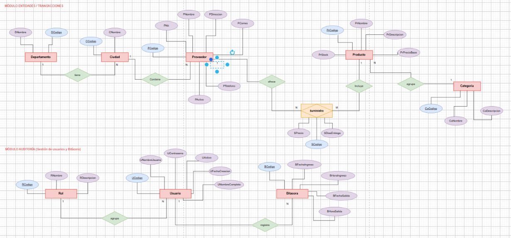
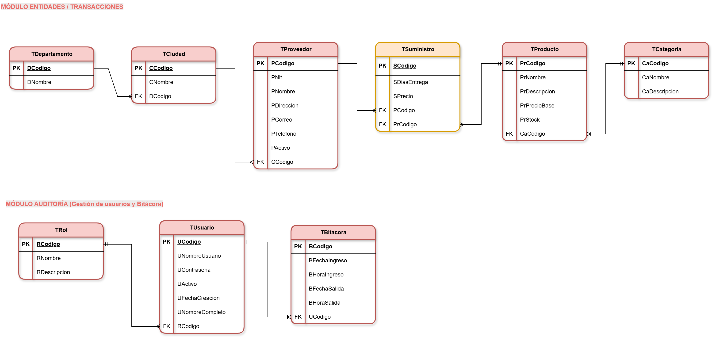

<div align="center">

# UNIVERSIDAD DEL QUINDÍO

**Facultad de Ingeniería**
**Programa de Ingeniería de Sistemas y Computación**

**BASES DE DATOS I**

<br>

## PROYECTO FINAL
### Sistema de gestión de proveedores, productos y categorías

<br>

**Integrantes:**

[Nombre 1]
[Nombre 2]
[Nombre 3]

<br>

Armenia, Quindío
Noviembre de 2026

</div>

---

## Contenido

1. [Explicación general de la aplicación](#1-explicación-general-de-la-aplicación)
2. [Diagrama Entidad-Relación](#2-diagrama-entidad-relación)
3. [Diccionario de datos](#3-diccionario-de-datos)
4. [Diagrama relacional normalizado](#4-diagrama-relacional-normalizado)
5. [Consultas](#5-consultas)
6. [Reportes](#6-reportes)
7. [Instalación y ejecución](#7-instalación-y-ejecución)

---

## 1. Explicación general de la aplicación

### 1.1 Problema

Las empresas comerciales necesitan saber **a qué proveedores les pueden hacer los pedidos de sus productos**. Los proveedores pueden estar en cualquier ciudad de Colombia, un proveedor puede ofrecer varios productos y un mismo producto se puede conseguir con varios proveedores (cada uno con su propio precio y tiempo de entrega). Además, los productos se clasifican en categorías (familias de productos).

La aplicación que construimos permite registrar toda esta información, asignar qué productos ofrece cada proveedor, consultarla y sacar reportes en PDF. También tiene un sistema de seguridad con login, tres tipos de usuario y una bitácora de entradas y salidas.

### 1.2 Tecnologías

| Elemento | Herramienta |
|----------|-------------|
| Lenguaje | Java (JDK 25) |
| Interfaz gráfica | Swing (aplicación de escritorio) |
| Base de datos | Oracle (XE 21c / Free 23ai) |
| Conexión | JDBC puro con el driver `ojdbc11` |
| Reportes | Apache PDFBox (genera el PDF) y un visor propio dentro de la aplicación |
| Construcción | Maven |

### 1.3 Módulos

La ventana principal (`MenuPrincipal`) es un escritorio con ventanas internas y tiene los menús que pide el enunciado:

| Módulo | Menú / Ventana | Qué hace |
|--------|----------------|----------|
| **Ingreso** | Ventana de *Login* | Pide usuario y contraseña, valida contra `TUsuario` (clave en SHA-256), permite máximo 3 intentos y registra la entrada en la bitácora. Si el usuario está inactivo no lo deja entrar. |
| **Entidades** | Departamentos, Ciudades, Categorías, Productos, Proveedores | CRUD completo (`INSERT`, `SELECT`, `UPDATE`, `DELETE`) de cada entidad, con búsqueda por nombre y validaciones. |
| **Transacciones** | Suministros | Asigna productos a proveedores con su precio de suministro y días de entrega (tabla `TSuministro`, que resuelve la relación muchos a muchos). |
| **Reportes/Consultas** | Consultas, Reportes | 5 consultas (3 con JOIN de 3 o más tablas y 2 con subconsultas) mostradas en una tabla, y 5 reportes en PDF filtrados por el usuario y mostrados en un visor dentro de la aplicación. |
| **Auditoría** | Gestión de usuarios, Bitácora | El administrador crea, edita, activa/desactiva usuarios y les cambia la clave; también consulta la bitácora de entradas y salidas filtrando por fechas y usuario. |
| **Sesión** | Cerrar sesión, Salir | Registra la salida en la bitácora. "Cerrar sesión" vuelve al Login y "Salir" cierra la aplicación. |

### 1.4 Tipos de usuario y matriz de permisos

El enunciado pide tres tipos de usuario. Están en la tabla `TRol` con códigos fijos:

| Código | Rol | Descripción |
|:------:|-----|-------------|
| 1 | ADMINISTRADOR | Único usuario que puede crear nuevos usuarios. Solo puede existir uno. |
| 2 | TRADICIONAL | Ejecuta los CRUD de gestión de datos. |
| 3 | ESPORADICO | Solo ejecuta las consultas (y los reportes). |

**Matriz de permisos** (lo que ve y puede hacer cada rol después de ingresar):

| Módulo / acción | Administrador | Tradicional | Esporádico |
|-----------------|:-------------:|:-----------:|:----------:|
| Ingresar al sistema (Login) | ✔ | ✔ | ✔ |
| Entidades (CRUD de Departamentos, Ciudades, Categorías, Productos y Proveedores) | ✔ | ✔ | ✘ |
| Transacciones (Suministros) | ✔ | ✔ | ✘ |
| Consultas | ✔ | ✔ | ✔ |
| Reportes en PDF | ✔ | ✔ | ✔ |
| Gestión de usuarios | ✔ | ✘ | ✘ |
| Bitácora de entrada y salida | ✔ | ✘ | ✘ |
| Cerrar sesión / Salir | ✔ | ✔ | ✔ |

Los permisos se controlan en dos lugares:

1. **En el menú:** `MenuPrincipal` solo agrega los menús que el rol puede usar (por ejemplo, el esporádico no ve *Entidades* ni *Transacciones*, y solo el administrador ve *Auditoría*).
2. **En los controladores:** antes de guardar, editar o eliminar, cada controlador vuelve a revisar el permiso con la clase `Sesion` (`puedeEditar()`, `puedeGestionarUsuarios()`, `puedeVerBitacora()`). Así, aunque alguien llegara a abrir una ventana, el controlador no deja hacer la operación.

### 1.5 Arquitectura en capas

La aplicación sigue el patrón **Modelo – Vista – Controlador** con objetos **DAO** y **DTO**, como recomienda el anexo del proyecto. El paquete raíz es `co.edu.uniquindio.proyectobasesdedatos`:

```
vista  ──►  controlador  ──►  modelo.dao  ──►  Oracle (JDBC)
  │              │                 │
  └──────────────┴──── modelo.dto ─┘   (objetos que viajan entre capas)
```

| Paquete | Responsabilidad |
|---------|-----------------|
| `vista` | Ventanas Swing (`JInternalFrame`, `JDialog`). Solo muestran datos y capturan eventos; **nunca escriben SQL**. Los errores se muestran con `JOptionPane`. |
| `controlador` | Valida los datos (obligatorios, longitudes, formatos, rangos), revisa permisos y llama al DAO. Si algo falla lanza `ControladorException` con un mensaje claro en español. |
| `modelo.dao` | Una clase por tabla (`ProveedorDAO`, `ProductoDAO`, `SuministroDAO`, `UsuarioDAO`, `BitacoraDAO`, etc.) con las sentencias `INSERT`, `SELECT`, `UPDATE` y `DELETE`. Usan **siempre `PreparedStatement` con parámetros `?`** (evita la inyección SQL) y *try-with-resources* para cerrar conexiones. **No muestran mensajes**: lanzan `SQLException`. |
| `modelo.dto` | Objetos que representan una fila de cada tabla (`ProveedorDTO`, `ProductoDTO`, ...). Algunos traen además datos de solo lectura que vienen de un JOIN (por ejemplo, el nombre de la ciudad del proveedor). |
| `config` | `ConexionOracle`: lee `db.properties` y entrega conexiones JDBC. |
| `util` | `Sesion` (usuario conectado y permisos), `Seguridad` (hash SHA-256), `ErroresBD` (traduce los códigos `ORA-xxxxx` a mensajes en español) y `GeneradorPDF`. |

**¿Por qué sin frameworks?** El enunciado lo prohíbe explícitamente, y además el objetivo del curso es practicar SQL: con JDBC puro cada consulta está escrita a mano, se ve exactamente qué se le envía a Oracle y se trabaja directamente con llaves primarias, foráneas, restricciones y transacciones. Las únicas librerías externas son el driver de Oracle (`ojdbc11`, obligatorio para conectarse) y PDFBox (solo para dibujar el PDF de los reportes). Las ventanas también se escribieron a mano con Swing, sin generadores de formularios.

### 1.6 Seguridad

- **Contraseñas con hash SHA-256:** la clave nunca se guarda en texto plano. La clase `Seguridad` calcula el SHA-256 y lo guarda en hexadecimal (64 caracteres) en `TUsuario.UContrasena`. Al ingresar se calcula el hash de lo que escribió el usuario y se compara con el guardado. Los scripts SQL usan `STANDARD_HASH(..., 'SHA256')` de Oracle, que produce exactamente el mismo valor.
- **Un solo administrador, garantizado por la base de datos:** además de la validación en `UsuarioControlador`, el script crea un **índice único basado en función**:

  ```sql
  CREATE UNIQUE INDEX ux_usuario_unico_admin
      ON TUsuario (CASE WHEN RCodigo = 1 THEN 1 END);
  ```

  Para los usuarios que no son administradores la expresión da `NULL` y Oracle no indexa los `NULL`, así que no cuentan. Para el administrador da `1`, y como el índice es único, un segundo administrador provoca el error `ORA-00001`. Aunque alguien intente insertarlo directamente desde SQL Developer, la base de datos no lo permite.
- **Otras reglas:** el administrador no puede desactivarse ni quitarse el rol a sí mismo; un usuario inactivo (`UActivo = 0`) no puede ingresar; el Login se cierra después de 3 intentos fallidos y el mensaje de error no dice si lo que falló fue el usuario o la clave.
- **Bitácora:** cada ingreso inserta una fila en `TBitacora` (fecha y hora de entrada con los valores por defecto de Oracle) y al cerrar sesión, salir o cerrar la ventana se completa la fecha y hora de salida. Hay un *shutdown hook* de respaldo por si la aplicación se cierra de otra forma.
- **Inyección SQL:** todos los valores que escribe el usuario viajan como parámetros `?` de `PreparedStatement`; nunca se concatenan al SQL.

---

## 2. Diagrama Entidad-Relación



El modelo tiene **8 entidades** y una **entidad asociativa** (`Suministro`), organizadas en dos módulos.

### 2.1 Módulo Entidades / Transacciones

| Relación | Entidades | Cardinalidad | Explicación |
|----------|-----------|:------------:|-------------|
| **tiene** | Departamento – Ciudad | 1 : N | Un departamento tiene muchas ciudades; cada ciudad pertenece a un solo departamento. En el modelo relacional `TCiudad` guarda la llave foránea `DCodigo`. |
| **contiene** | Ciudad – Proveedor | 1 : N | En una ciudad puede haber muchos proveedores; cada proveedor está ubicado en una sola ciudad. `TProveedor` guarda `CCodigo`. |
| **agrupa** | Categoría – Producto | 1 : N | Una categoría agrupa muchos productos (una familia de productos); cada producto pertenece a una sola categoría. `TProducto` guarda `CaCodigo`. |
| **ofrece / incluye** | Proveedor – Producto (a través de Suministro) | N : M | Como dice el enunciado, un proveedor puede proveer varios productos y un producto puede ser adquirido de varios proveedores. Esta relación muchos a muchos se resuelve con la entidad asociativa **Suministro**, que además tiene atributos propios: el **precio** al que ese proveedor vende ese producto y los **días de entrega**. Un proveedor ofrece N suministros y un producto está incluido en M suministros; cada suministro une exactamente un proveedor con un producto. |

### 2.2 Módulo Auditoría

| Relación | Entidades | Cardinalidad | Explicación |
|----------|-----------|:------------:|-------------|
| **agrupa** | Rol – Usuario | 1 : N | Cada usuario tiene un solo rol (Administrador, Tradicional o Esporádico) y un rol puede tener muchos usuarios. La excepción es el rol Administrador, que por regla del negocio solo puede tener un usuario (se controla con un índice único). `TUsuario` guarda `RCodigo`. |
| **registra** | Usuario – Bitácora | 1 : N | Cada vez que un usuario entra al sistema se registra una fila en la bitácora con la fecha y hora de entrada y, al salir, la fecha y hora de salida. Un usuario tiene muchos registros; cada registro es de un solo usuario. `TBitacora` guarda `UCodigo`. |

### 2.3 Decisiones de diseño

- **Ciudad y Departamento como entidades** (y no como texto dentro del proveedor) para no repetir nombres, evitar errores de escritura y poder filtrar los reportes por ubicación.
- **Llaves primarias sustitutas** numéricas (`...Codigo`) generadas con `IDENTITY` de Oracle. Los datos naturales que deben ser únicos (NIT del proveedor, nombre de usuario, nombres de departamento, categoría y rol) tienen restricción `UNIQUE`.
- **Suministro con llave propia** (`SCodigo`) y además `UNIQUE (PCodigo, PrCodigo)` para que un proveedor no pueda tener dos veces el mismo producto.
- **Proveedor activo/inactivo** (`PActivo`) para "dar de baja" un proveedor sin borrar su historial de suministros.
- **Bitácora con fecha y hora separadas**, tal como aparecen en el diagrama ER (`BFechaIngreso`, `BHoraIngreso`, `BFechaSalida`, `BHoraSalida`).

---

## 3. Diccionario de datos

Tomado del script `sql/01_crear_tablas.sql` (Oracle 12c o superior). Convenciones:

- **Llave:** `PK` = llave primaria, `FK` = llave foránea, `UQ` = único.
- **Nulo:** `No` = la columna es `NOT NULL`.
- Todas las llaves primarias son `NUMBER GENERATED BY DEFAULT AS IDENTITY`: Oracle genera el código automáticamente (1, 2, 3, ...) si no se envía uno.
- Las llaves foráneas tienen además un índice (`ix_...`) porque Oracle no los crea solo; esto acelera los JOIN y la verificación de integridad al borrar.

### 3.1 TDepartamento

Departamentos de Colombia donde se ubican las ciudades de los proveedores.

| Columna | Tipo | Nulo | Llave | Default | Restricción | Descripción |
|---------|------|:----:|:-----:|---------|-------------|-------------|
| DCodigo | NUMBER | No | PK | IDENTITY | `pk_departamento` | Código único del departamento. |
| DNombre | VARCHAR2(60) | No | UQ | — | `uq_departamento_nombre` | Nombre del departamento (p. ej. "Quindío"). No se puede repetir. |

### 3.2 TCiudad

Ciudades (municipios) donde están ubicados los proveedores. Cada ciudad pertenece a un departamento.

| Columna | Tipo | Nulo | Llave | Default | Restricción | Descripción |
|---------|------|:----:|:-----:|---------|-------------|-------------|
| CCodigo | NUMBER | No | PK | IDENTITY | `pk_ciudad` | Código único de la ciudad. |
| CNombre | VARCHAR2(60) | No | — | — | — | Nombre de la ciudad (p. ej. "Armenia"). Puede repetirse en departamentos distintos. |
| DCodigo | NUMBER | No | FK | — | `fk_ciudad_departamento` → `TDepartamento(DCodigo)`; índice `ix_ciudad_dep` | Departamento al que pertenece la ciudad. |

### 3.3 TCategoria

Categorías o familias en las que se clasifican los productos.

| Columna | Tipo | Nulo | Llave | Default | Restricción | Descripción |
|---------|------|:----:|:-----:|---------|-------------|-------------|
| CaCodigo | NUMBER | No | PK | IDENTITY | `pk_categoria` | Código único de la categoría. |
| CaNombre | VARCHAR2(60) | No | UQ | — | `uq_categoria_nombre` | Nombre de la categoría (p. ej. "Papelería"). No se puede repetir. |
| CaDescripcion | VARCHAR2(200) | Sí | — | — | — | Descripción de qué tipo de productos agrupa. |

### 3.4 TProveedor

Empresas a las que se les pueden hacer pedidos de productos.

| Columna | Tipo | Nulo | Llave | Default | Restricción | Descripción |
|---------|------|:----:|:-----:|---------|-------------|-------------|
| PCodigo | NUMBER | No | PK | IDENTITY | `pk_proveedor` | Código único del proveedor. |
| PNit | VARCHAR2(20) | No | UQ | — | `uq_proveedor_nit` | NIT de la empresa (p. ej. "900123456-7"). No se puede repetir. |
| PNombre | VARCHAR2(100) | No | — | — | — | Razón social del proveedor. |
| PDireccion | VARCHAR2(120) | Sí | — | — | — | Dirección física. |
| PCorreo | VARCHAR2(100) | Sí | — | — | — | Correo electrónico de contacto (la aplicación valida el formato). |
| PTelefono | VARCHAR2(20) | Sí | — | — | — | Teléfono de contacto. Es texto para admitir "+", espacios y guiones. |
| PActivo | NUMBER(1) | No | — | `1` | `ck_proveedor_activo`: `PActivo IN (0, 1)` | 1 = activo, 0 = inactivo. Solo a los activos se les pueden asignar productos. |
| CCodigo | NUMBER | No | FK | — | `fk_proveedor_ciudad` → `TCiudad(CCodigo)`; índice `ix_proveedor_ciu` | Ciudad donde está ubicado el proveedor. |

### 3.5 TProducto

Productos que la empresa puede pedir a los proveedores.

| Columna | Tipo | Nulo | Llave | Default | Restricción | Descripción |
|---------|------|:----:|:-----:|---------|-------------|-------------|
| PrCodigo | NUMBER | No | PK | IDENTITY | `pk_producto` | Código único del producto. |
| PrNombre | VARCHAR2(100) | No | — | — | — | Nombre del producto. |
| PrDescripcion | VARCHAR2(250) | Sí | — | — | — | Descripción o características. |
| PrPrecioBase | NUMBER(12,2) | No | — | — | `ck_producto_precio`: `PrPrecioBase >= 0` | Precio de referencia del producto (hasta 10 enteros y 2 decimales). |
| PrStock | NUMBER(8) | No | — | `0` | `ck_producto_stock`: `PrStock >= 0` | Unidades disponibles en inventario. |
| CaCodigo | NUMBER | No | FK | — | `fk_producto_categoria` → `TCategoria(CaCodigo)`; índice `ix_producto_cat` | Categoría a la que pertenece el producto. |

### 3.6 TSuministro

Entidad asociativa que resuelve la relación muchos a muchos entre Proveedor y Producto: indica qué productos ofrece cada proveedor, a qué precio y en cuántos días los entrega.

| Columna | Tipo | Nulo | Llave | Default | Restricción | Descripción |
|---------|------|:----:|:-----:|---------|-------------|-------------|
| SCodigo | NUMBER | No | PK | IDENTITY | `pk_suministro` | Código único del suministro. |
| SDiasEntrega | NUMBER(3) | No | — | — | `ck_suministro_dias`: `SDiasEntrega >= 0` | Días que tarda el proveedor en entregar el producto (0 a 999). |
| SPrecio | NUMBER(12,2) | No | — | — | `ck_suministro_precio`: `SPrecio >= 0` | Precio al que este proveedor vende este producto. |
| PCodigo | NUMBER | No | FK, UQ\* | — | `fk_suministro_proveedor` → `TProveedor(PCodigo)` | Proveedor que ofrece el producto. |
| PrCodigo | NUMBER | No | FK, UQ\* | — | `fk_suministro_producto` → `TProducto(PrCodigo)`; índice `ix_suministro_prod` | Producto ofrecido. |

\* `uq_suministro_prov_prod UNIQUE (PCodigo, PrCodigo)`: un proveedor no puede tener dos veces el mismo producto. Este índice único también sirve como índice de la llave foránea `PCodigo` (es su primera columna).

### 3.7 TRol

Tipos de usuario del sistema. Los códigos son fijos porque el índice del administrador y la clase `RolDTO` dependen de ellos.

| Columna | Tipo | Nulo | Llave | Default | Restricción | Descripción |
|---------|------|:----:|:-----:|---------|-------------|-------------|
| RCodigo | NUMBER | No | PK | IDENTITY | `pk_rol` | Código del rol: 1 = ADMINISTRADOR, 2 = TRADICIONAL, 3 = ESPORADICO. |
| RNombre | VARCHAR2(30) | No | UQ | — | `uq_rol_nombre` | Nombre del rol. |
| RDescripcion | VARCHAR2(150) | Sí | — | — | — | Qué puede hacer el rol. |

### 3.8 TUsuario

Usuarios que pueden ingresar a la aplicación.

| Columna | Tipo | Nulo | Llave | Default | Restricción | Descripción |
|---------|------|:----:|:-----:|---------|-------------|-------------|
| UCodigo | NUMBER | No | PK | IDENTITY | `pk_usuario` | Código único del usuario. |
| UNombreUsuario | VARCHAR2(30) | No | UQ | — | `uq_usuario_nombre` | Nombre con el que ingresa (login). La aplicación exige 4 a 30 caracteres sin espacios. |
| UContrasena | VARCHAR2(100) | No | — | — | — | **Hash SHA-256** de la contraseña en hexadecimal (64 caracteres). Nunca se guarda la clave en texto plano. |
| UActivo | NUMBER(1) | No | — | `1` | `ck_usuario_activo`: `UActivo IN (0, 1)` | 1 = puede ingresar, 0 = bloqueado. |
| UFechaCreacion | DATE | No | — | `SYSDATE` | — | Fecha y hora en que se creó el usuario. |
| UNombreCompleto | VARCHAR2(100) | No | — | — | — | Nombre real de la persona. |
| RCodigo | NUMBER | No | FK | — | `fk_usuario_rol` → `TRol(RCodigo)`; índice `ix_usuario_rol`; índice único `ux_usuario_unico_admin` | Rol del usuario. El índice único sobre `CASE WHEN RCodigo = 1 THEN 1 END` impide que exista más de un administrador. |

### 3.9 TBitacora

Registro de cada ingreso y salida de los usuarios del sistema.

| Columna | Tipo | Nulo | Llave | Default | Restricción | Descripción |
|---------|------|:----:|:-----:|---------|-------------|-------------|
| BCodigo | NUMBER | No | PK | IDENTITY | `pk_bitacora` | Código único del registro. |
| BFechaIngreso | DATE | No | — | `TRUNC(SYSDATE)` | `ck_bitacora_fecha_ing`: solo el día, sin hora | Fecha en que el usuario ingresó. |
| BHoraIngreso | VARCHAR2(8) | No | — | `TO_CHAR(SYSDATE, 'HH24:MI:SS')` | `ck_bitacora_hora_ing`: formato `HH24:MI:SS` válido (`REGEXP_LIKE`) | Hora de ingreso (p. ej. "14:05:09"). |
| BFechaSalida | DATE | Sí | — | — | `ck_bitacora_fecha_sal`: solo el día | Fecha de salida. `NULL` mientras la sesión sigue abierta. |
| BHoraSalida | VARCHAR2(8) | Sí | — | — | `ck_bitacora_hora_sal`: formato `HH24:MI:SS` válido | Hora de salida. `NULL` mientras la sesión sigue abierta. |
| UCodigo | NUMBER | No | FK | — | `fk_bitacora_usuario` → `TUsuario(UCodigo)`; índice `ix_bitacora_usu` | Usuario que ingresó. |

Restricciones adicionales de la tabla:

- `ck_bitacora_salida_completa`: la fecha y la hora de salida van juntas (ambas `NULL` o ambas con valor).
- `ck_bitacora_orden`: la salida no puede ser anterior al ingreso (si es el mismo día, la hora de salida debe ser mayor o igual; como la hora tiene formato fijo `HH24:MI:SS`, se puede comparar como texto).

---

## 4. Diagrama relacional normalizado



En notación de texto (llave primaria **subrayada** en el diagrama, aquí en **negrita**; llaves foráneas con `#`):

```
TDepartamento (DCodigo, DNombre)
TCiudad       (CCodigo, CNombre, #DCodigo)
TCategoria    (CaCodigo, CaNombre, CaDescripcion)
TProveedor    (PCodigo, PNit, PNombre, PDireccion, PCorreo, PTelefono, PActivo, #CCodigo)
TProducto     (PrCodigo, PrNombre, PrDescripcion, PrPrecioBase, PrStock, #CaCodigo)
TSuministro   (SCodigo, SDiasEntrega, SPrecio, #PCodigo, #PrCodigo)      UNIQUE(PCodigo, PrCodigo)
TRol          (RCodigo, RNombre, RDescripcion)
TUsuario      (UCodigo, UNombreUsuario, UContrasena, UActivo, UFechaCreacion, UNombreCompleto, #RCodigo)
TBitacora     (BCodigo, BFechaIngreso, BHoraIngreso, BFechaSalida, BHoraSalida, #UCodigo)
```

Paso del modelo ER al relacional:

- Cada **entidad** se convirtió en una tabla con su llave primaria.
- Cada relación **1 : N** se convirtió en una llave foránea en la tabla del lado N (`TCiudad.DCodigo`, `TProveedor.CCodigo`, `TProducto.CaCodigo`, `TUsuario.RCodigo`, `TBitacora.UCodigo`).
- La relación **N : M** entre Proveedor y Producto se convirtió en la tabla `TSuministro`, con una llave foránea hacia cada lado y sus atributos propios (precio y días de entrega).

### 4.1 Justificación de la normalización

**Primera Forma Normal (1FN).** Una tabla está en 1FN si todos sus atributos son atómicos (un solo valor por celda), no hay grupos repetitivos y cada fila se identifica por una llave primaria.

- Todas las tablas tienen llave primaria.
- No hay columnas con listas: por ejemplo, en lugar de guardar en el proveedor una lista de "productos que vende", cada pareja proveedor-producto es una fila de `TSuministro`.
- La ubicación no se guarda como un texto "Armenia, Quindío", sino separada en `TCiudad` y `TDepartamento`.
- La fecha y la hora de la bitácora se guardan en columnas separadas, cada una con un solo valor.

**Segunda Forma Normal (2FN).** Está en 1FN y ningún atributo que no es llave depende solo de una parte de una llave compuesta.

- Todas las tablas usan una llave primaria simple (una sola columna `...Codigo`), así que no puede existir dependencia parcial.
- El caso a revisar es `TSuministro`, cuya llave candidata natural es compuesta: `(PCodigo, PrCodigo)`. Sus atributos `SPrecio` y `SDiasEntrega` dependen de **la pareja completa** (el precio y los días son de *ese* proveedor para *ese* producto), no solo del proveedor ni solo del producto. En cambio, el nombre del proveedor o el precio base del producto (que sí dependen de una sola parte) **no** están en `TSuministro`, sino en `TProveedor` y `TProducto`. Por eso cumple 2FN.

**Tercera Forma Normal (3FN).** Está en 2FN y no hay dependencias transitivas: ningún atributo que no es llave depende de otro atributo que tampoco es llave.

- `TProveedor` guarda solo `CCodigo`, no el nombre de la ciudad ni el del departamento. Si guardara `CNombre` y `DNombre`, estos dependerían de `CCodigo` (transitividad `PCodigo → CCodigo → CNombre`), y al cambiar el nombre de una ciudad habría que actualizar muchos proveedores. Por eso la ciudad y el departamento están en sus propias tablas.
- Del mismo modo, `TCiudad` guarda solo `DCodigo` (no el nombre del departamento), `TProducto` guarda solo `CaCodigo` (no el nombre de la categoría), `TUsuario` guarda solo `RCodigo` (no el nombre del rol) y `TBitacora` guarda solo `UCodigo` (no el nombre del usuario).
- No se guardan datos calculados: la diferencia entre el precio de suministro y el precio base, los promedios por categoría o la cantidad de proveedores de un producto se calculan en las consultas y reportes.

Con esto el modelo queda en **3FN**: cada dato se guarda en un solo lugar, y los nombres que se ven juntos en la aplicación se obtienen con JOIN.

---

## 5. Consultas

El enunciado pide:

> - Tres consultas con **JOIN** que junten al menos datos de **3 tablas**.
> - Dos consultas que posean **subconsultas** y que relacionen **dos tablas**.

Están en `modelo/dao/ConsultaDAO.java` y se ejecutan desde **Reportes/Consultas → Consultas** (las pueden usar los tres roles). El SQL completo y la justificación de cada una están en el documento [`Consultas.md`](Consultas.md); aquí va el resumen:

| # | Consulta | Tipo | Tablas | Requisito que cumple |
|---|----------|------|--------|----------------------|
| a | Proveedores con ciudad y departamento | JOIN | TProveedor, TCiudad, TDepartamento | JOIN de 3 tablas (1 de 3) |
| b | Productos con proveedores y precio de suministro (y diferencia con el precio base) | JOIN | TProducto, TSuministro, TProveedor | JOIN de 3 tablas (2 de 3) |
| c | Productos por categoría y proveedor, con stock y días de entrega | JOIN | TProducto, TCategoria, TSuministro, TProveedor | JOIN de 4 tablas (3 de 3) |
| d | Productos con precio base mayor al promedio de su categoría | Subconsulta correlacionada en el `WHERE` + subconsulta escalar en el `SELECT` | TProducto, TCategoria | Subconsulta que relaciona 2 tablas (1 de 2) |
| e | Proveedores sin suministros | Subconsulta con `NOT EXISTS` | TProveedor, TSuministro | Subconsulta que relaciona 2 tablas (2 de 2) |

Ejemplo (consulta d):

```sql
SELECT ca.CaNombre, pr.PrNombre, pr.PrPrecioBase,
       (SELECT ROUND(AVG(p3.PrPrecioBase), 2)
          FROM TProducto p3
         WHERE p3.CaCodigo = pr.CaCodigo) AS PromedioCategoria
FROM TProducto pr
JOIN TCategoria ca ON ca.CaCodigo = pr.CaCodigo
WHERE pr.PrPrecioBase > (SELECT AVG(p2.PrPrecioBase)
                           FROM TProducto p2
                          WHERE p2.CaCodigo = pr.CaCodigo)
ORDER BY ca.CaNombre, pr.PrPrecioBase DESC;
```

---

## 6. Reportes

El enunciado pide reportes en PDF (o en una herramienta de reportes) **mostrados dentro de un formulario de la aplicación**:

> - **Tres** reportes diferentes con los datos **filtrados por el usuario**, de productos y proveedores.
> - **Dos** reportes que relacionen los **Productos con sus Categorías** y que los pueda filtrar el usuario.

Se generan desde **Reportes/Consultas → Reportes** (una pestaña por reporte). El usuario elige los filtros, pulsa **Generar PDF** y escoge dónde guardar el archivo; el PDF se crea con PDFBox (`util/GeneradorPDF`) y se abre en un visor dentro de la aplicación (`vista/reportes/VisorPDF`), con paginación y zoom. Las consultas están en `modelo/dao/ReporteDAO.java`; los filtros opcionales se agregan al `WHERE` siempre como parámetros `?`.

| # | Reporte | Filtros del usuario | Tablas | Requisito que cumple |
|---|---------|---------------------|--------|----------------------|
| 1 | **Proveedores por departamento y ciudad** | Departamento (o todos) y ciudad (o todas) | TProveedor, TCiudad, TDepartamento | Reporte filtrado de **proveedores** (1 de 3) |
| 2 | **Productos por rango de precio y stock** | Precio mínimo/máximo y stock mínimo/máximo (todos opcionales) | TProducto, TCategoria | Reporte filtrado de **productos** (2 de 3) |
| 3 | **Productos suministrados por un proveedor** | Proveedor | TSuministro, TProducto, TCategoria | Reporte filtrado de **productos y proveedores** (3 de 3). Incluye fila de totales y promedio de días de entrega. |
| 4 | **Productos por categoría** | Categoría | TProducto, TSuministro (LEFT JOIN para contar proveedores) | Reporte de **productos con su categoría** filtrado (1 de 2) |
| 5 | **Resumen de productos por categoría** | Categoría (o todas) | TCategoria, TProducto (LEFT JOIN) | Reporte de **productos con su categoría** filtrado (2 de 2): cantidad de productos, precio promedio, mínimo y máximo, y stock total, con fila de totales. |

Detalles:

- En el reporte 1, el combo de ciudades depende del departamento elegido, y el controlador valida que la ciudad pertenezca al departamento.
- En el reporte 2 se valida que los valores no sean negativos y que el mínimo no sea mayor que el máximo.
- Los reportes 4 y 5 usan `LEFT JOIN` para que también aparezcan los productos sin proveedores y las categorías sin productos (con 0).
- Cada PDF lleva título, los filtros aplicados y la cantidad de registros en el subtítulo, un pie con la fecha y hora de generación, el usuario que lo generó y "Página X de Y", y los valores con formato colombiano (`$ 28.900,00`).

---

## 7. Instalación y ejecución

### 7.1 Requisitos

- **JDK 25** (la variable `JAVA_HOME` debe apuntar a él).
- **Apache Maven 3.9** o superior (o el Maven que trae NetBeans).
- **Oracle Database** XE 21c, Free 23ai o cualquier versión 12c o superior.
- **SQL Developer** (u otra herramienta para ejecutar scripts SQL).

Las dependencias (`ojdbc11` y `pdfbox`) las descarga Maven automáticamente.

### 7.2 Crear el usuario de la base de datos (opcional)

Como `SYSTEM`, en la base de datos conectable (en XE 21c es `XEPDB1`, en Free 23ai es `FREEPDB1`):

```sql
ALTER SESSION SET CONTAINER = XEPDB1;
CREATE USER PROYECTO_BD IDENTIFIED BY "cambiar_esta_clave"
    DEFAULT TABLESPACE USERS QUOTA UNLIMITED ON USERS;
GRANT CREATE SESSION, CREATE TABLE, CREATE VIEW, CREATE SEQUENCE TO PROYECTO_BD;
```

### 7.3 Ejecutar los scripts SQL

Conectado con el usuario del proyecto, ejecutar **en este orden** los scripts de la carpeta `sql/` (en SQL Developer: abrir el archivo y pulsar *Ejecutar script*, F5):

| Orden | Script | Qué hace |
|:-----:|--------|----------|
| 0 | `00_borrar_tablas.sql` | *(Opcional)* Borra todas las tablas para empezar de cero. La primera vez muestra `ORA-00942` porque las tablas no existen; se puede ignorar. |
| 1 | `01_crear_tablas.sql` | Crea las 9 tablas con sus llaves, restricciones e índices. |
| 2 | `02_datos_iniciales.sql` | Inserta los 3 roles, el usuario administrador y algunos departamentos y ciudades. |
| 3 | `03_datos_prueba.sql` | Inserta datos de prueba: departamentos, ciudades, 5 categorías, 20 productos, 9 proveedores, 32 suministros y los usuarios tradicional y esporádico. |

Si se ejecuta `03_datos_prueba.sql` dos veces sin borrar, Oracle muestra `ORA-00001` por los datos únicos: hay que volver a correr 00 → 01 → 02 → 03.

### 7.4 Configurar la conexión (`db.properties`)

1. En `src/main/resources/` copiar `db.properties.example` con el nombre `db.properties`.
2. Editar la URL, el usuario y la contraseña:

   ```properties
   # Oracle XE 21c:     jdbc:oracle:thin:@//localhost:1521/XEPDB1
   # Oracle Free 23ai:  jdbc:oracle:thin:@//localhost:1521/FREEPDB1
   db.url=jdbc:oracle:thin:@//localhost:1521/XEPDB1
   db.user=PROYECTO_BD
   db.password=cambiar_esta_clave
   ```

`db.properties` está en el `.gitignore` para no subir la contraseña a GitHub.

### 7.5 Compilar y ejecutar

Desde la carpeta del proyecto:

```bash
mvn package            # compila y genera target/ProyectoBasesDeDatos-1.0-SNAPSHOT.jar
mvn exec:java          # ejecuta la clase principal (co.edu.uniquindio.proyectobasesdedatos.ProyectoBasesDeDatos)
```

También se puede abrir el proyecto en **NetBeans** (o IntelliJ / Eclipse) como proyecto Maven y ejecutar la clase `ProyectoBasesDeDatos`.

Al iniciar, la aplicación prueba la conexión con Oracle; si falla, muestra un mensaje y se cierra (revisar que Oracle esté encendido y los datos de `db.properties`). Si la conexión funciona, aparece la ventana de **Login**.

### 7.6 Credenciales de prueba

| Usuario | Contraseña | Rol | Creado en |
|---------|------------|-----|-----------|
| `admin` | `Admin123*` | ADMINISTRADOR | `02_datos_iniciales.sql` |
| `tradicional` | `Trad123*` | TRADICIONAL | `03_datos_prueba.sql` |
| `esporadico` | `Espo123*` | ESPORADICO | `03_datos_prueba.sql` |

Se recomienda cambiar la clave del administrador desde **Auditoría → Gestión de usuarios** después del primer ingreso.

La guía paso a paso para probar la aplicación con los tres usuarios está en [`PruebasIntegracion.md`](PruebasIntegracion.md).
